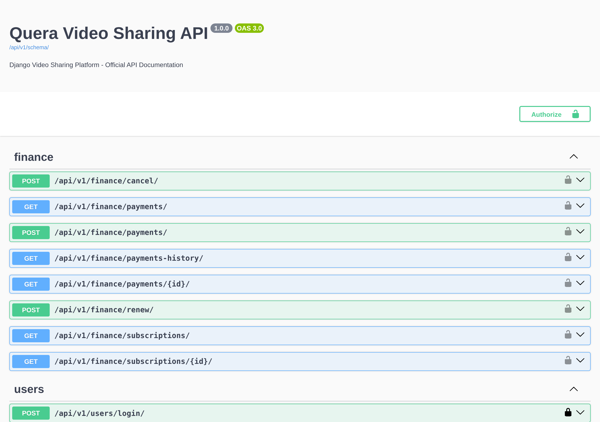

# Quera Video Sharing




A Django REST API for a video-sharing service. It provides user accounts, video uploads, comments, ratings, watch history, and simulated subscriptions and payments.

This repository contains the backend only. It does not include a frontend, video transcoding, or a streaming service.

## Contents

- [Features](#features)
- [Tech stack](#tech-stack)
- [Getting started](#getting-started)
- [API reference](#api-reference)
- [Example requests](#example-requests)
- [Project structure](#project-structure)
- [Testing](#testing)
- [Configuration](#configuration)
- [Known limitations](#known-limitations)

## Features

- **Accounts:** registration with a unique email address, username and password login, and token authentication.
- **Videos:** create, read, update, and delete videos with file uploads. Only staff can manage videos. Premium videos are available only to subscribers.
- **Views and watch history:** opening a video's detail page increments its view counter. For authenticated users, it also records a watch-history entry.
- **Engagement:** comments and ratings. A rating is a score from 1 to 5, and each user can rate a video once. Only the owner, or staff, can change or delete a comment or rating.
- **Subscriptions and payments:** simulated payments create or extend a 30-day subscription. Renewal and cancellation have separate endpoints.
- **Tooling:** Django admin, session authentication for the browsable API, an OpenAPI schema, and Swagger UI.

## Tech stack

| Component | Version or configuration |
| --- | --- |
| Python | 3.14 |
| Django | 6.1.1 |
| Django REST Framework | 3.18.1 |
| drf-spectacular | 0.30.0 |
| Database | SQLite (`db.sqlite3`) |
| Authentication | DRF token authentication and Django sessions |

Exact dependency versions are pinned in [`requirements.txt`](requirements.txt).

## Getting started

**Prerequisites:** Git, Python 3.14 with `venv`, and access to a package index.

1. Clone the repository:

   ```bash
   git clone https://github.com/amirrezaparvaneh/quera_video_sharing.git
   cd quera_video_sharing
   ```

2. Create and activate a virtual environment:

   ```bash
   python3.14 -m venv venv
   source venv/bin/activate
   ```

   On Windows (PowerShell):

   ```powershell
   py -3.14 -m venv venv
   .\venv\Scripts\Activate.ps1
   ```

3. Install the dependencies:

   ```bash
   python -m pip install -r requirements.txt
   ```

4. Apply the migrations:

   ```bash
   python manage.py migrate
   ```

5. Optionally, create an administrator account:

   ```bash
   python manage.py createsuperuser
   ```

6. Check the configuration and start the development server:

   ```bash
   python manage.py check
   python manage.py runserver
   ```

The server listens on `http://127.0.0.1:8000/`. The root URL has no page. Use these instead:

| URL | Purpose |
| --- | --- |
| `/api/v1/docs/` | Swagger UI |
| `/api/v1/schema/` | Raw OpenAPI schema |
| `/admin/` | Django admin |
| `/api-auth/login/` | Session login for the browsable API |

## API reference

All API paths are under `/api/v1/` and end with a trailing slash. For CRUD resources, the collection path supports `GET` (list) and `POST` (create). The `<id>/` path supports `GET`, `PUT`, `PATCH`, and `DELETE`.

| Path | Methods | Description |
| --- | --- | --- |
| `/api/v1/users/register/` | `POST` | Register a user. Returns a token, user ID, and username. |
| `/api/v1/users/login/` | `POST` | Log in. Returns a token, user ID, and username. |
| `/api/v1/videos/videos/` | CRUD | Video metadata and file uploads |
| `/api/v1/videos/comments/` | CRUD | Comments |
| `/api/v1/videos/ratings/` | CRUD | Ratings |
| `/api/v1/videos/watch-history/` | `GET` | The current user's watch history, newest first |
| `/api/v1/finance/subscriptions/` | `GET` | The current user's subscriptions. Details at `<id>/`. |
| `/api/v1/finance/payments/` | CRUD | The current user's simulated payments |
| `/api/v1/finance/payments-history/` | `GET` | The current user's payment-history records, newest first |
| `/api/v1/finance/renew/` | `POST` | Extend or reactivate the subscription for 30 days |
| `/api/v1/finance/cancel/` | `POST` | Deactivate the current user's subscription |

### Access rules

- Registration and login are open to anonymous users.
- Anyone can read videos, comments, and ratings.
- A premium video's file URL is hidden in list responses for users without access. The detail page is available only to staff and to users with an active, unexpired subscription.
- Only staff can create, update, or delete videos.
- Comments and ratings require authentication. Only their owner, or staff, can change them. Premium videos require premium access.
- Finance and watch-history endpoints require authentication.

### Payments

Payments are simulated. No money is transferred and no payment gateway is involved. The price is set by `SUBSCRIPTION_PRICE` (50000). Each payment or renewal extends the user's single subscription by 30 days.

## Example requests

Replace `http://127.0.0.1:8000` with your server address if it differs.

**Register a user**

```bash
curl -X POST http://127.0.0.1:8000/api/v1/users/register/ \
  -H 'Content-Type: application/json' \
  -d '{"username":"demo","email":"demo@example.com","password":"ExamplePassword123!"}'
```

**Log in**

```bash
curl -X POST http://127.0.0.1:8000/api/v1/users/login/ \
  -H 'Content-Type: application/json' \
  -d '{"username":"demo","password":"ExamplePassword123!"}'
```

Store the returned `token`. Requests use the `Token` authorization scheme:

```bash
export API_TOKEN='replace-with-returned-token'
curl http://127.0.0.1:8000/api/v1/videos/watch-history/ \
  -H "Authorization: Token $API_TOKEN"
```

**Upload a video** (requires a staff account)

```bash
curl -X POST http://127.0.0.1:8000/api/v1/videos/videos/ \
  -H "Authorization: Token $API_TOKEN" \
  -F 'title=Demo video' \
  -F 'description=An example upload' \
  -F 'is_premium=false' \
  -F 'video_file=@/absolute/path/to/video.mp4'
```

**Create a simulated payment** (activates a 30-day subscription)

```bash
curl -X POST http://127.0.0.1:8000/api/v1/finance/payments/ \
  -H "Authorization: Token $API_TOKEN" \
  -H 'Content-Type: application/json' \
  -d '{"amount":"50000.00"}'
```

The client supplies `amount`, and no currency is defined. Renewal (`/api/v1/finance/renew/`) writes a `PaymentHistory` record with amount `50000` and status `Success`. Creating a `Payment` does not write that record.

## Project structure

```text
core/             Settings, root URL configuration, WSGI and ASGI entry points
users/            Custom user model, registration, login, and tests
videos/           Videos, comments, ratings, permissions, watch history, and tests
subscriptions/    Subscriptions, simulated payments, payment history, and tests
*/migrations/     Database migrations for each app
docs/             Entity relationship diagram (draw.io source and SVG) and screenshots
manage.py         Django management entry point
requirements.txt  Pinned dependencies
```

The diagram in `docs/` is a design reference. It does not include the `PaymentHistory` model. The models and migrations are the source of truth for the implemented schema.

## Testing

```bash
python manage.py test
```

The suite contains 41 tests covering registration, login, video and premium access, comments, ratings, watch history, and subscriptions. Uploaded files are written to a temporary media directory during tests.

## Configuration

Settings are read from environment variables. The defaults are for local development only.

| Variable | Default | Description |
| --- | --- | --- |
| `DJANGO_DEBUG` | `True` | Enables debug mode. Set to `False` in production. |
| `DJANGO_SECRET_KEY` | none | Required when `DJANGO_DEBUG` is `False`. |
| `DJANGO_ALLOWED_HOSTS` | empty | Comma-separated list of allowed host names. |

For production, set `DJANGO_DEBUG=False`, `DJANGO_SECRET_KEY`, and `DJANGO_ALLOWED_HOSTS`. Django does not start when debug mode is off and no secret key is set.

Uploaded files are stored in `media/`. Django serves them only while `DEBUG` is enabled.

## Known limitations

- **Payments:** payments are simulated and there is no payment gateway. `Payment` and `PaymentHistory` are separate records, not a unified ledger.
- **View counting:** opening a video's detail page counts as a view, not as confirmed playback. Repeated requests add watch-history entries.
- **Media delivery:** a premium video's file URL is visible to anyone who has access to it. The file itself is not protected once its URL is known. Production storage and protected delivery require separate configuration.
- **Database:** SQLite is used for local development.
